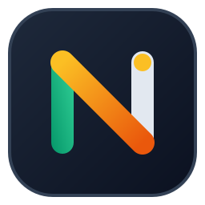

<p align="center">
  
</p>

<h1 align="center">NidoOS</h1>

<p align="center">
  <a href="../README.md">English</a> · <strong>Tiếng Việt</strong>
</p>

**NidoOS** là hệ điều hành máy tính để bàn AI-Native xây dựng trên nền tảng Ubuntu 26.04 LTS, tích hợp sẵn bộ gõ tiếng Việt **Sen Việt** (IBus Telex & VNI mặc định), bộ văn phòng **NidoOffice**, bộ tiện ích **NidoBox** và **NidoAgent**.

## Tải Bộ Cài

| Kiến trúc | Bộ cài | Phần cứng hỗ trợ |
| :--- | :--- | :--- |
| **`amd64` (`x86_64`)** | [**NidoOS-desktop-amd64.iso**](https://github.com/stevedat/NidoHub/releases/latest/download/NidoOS-desktop-amd64.iso) | PC & Laptop Intel / AMD (Khuyên dùng) |
| **`arm64` (`aarch64`)** | [**NidoOS-desktop-arm64.iso**](https://github.com/stevedat/NidoHub/releases/latest/download/NidoOS-desktop-arm64.iso) | Máy ảo Apple Silicon & hệ thống ARM64 (Beta) |

Kiểm tra toàn vẹn tệp bằng [`SHA256SUMS.txt`](https://github.com/stevedat/NidoHub/releases/latest/download/SHA256SUMS.txt):

```sh
sha256sum -c SHA256SUMS.txt
```

## Điểm nổi bật

- **Nido Minimal Desktop (Nền Ubuntu 26.04 LTS + GNOME Minimal):** Môi trường GNOME Wayland tinh gọn (GDM, Nautilus, Settings, PipeWire), xử lý chuẩn font chữ tiếng Việt có dấu (`Be Vietnam Pro` + `Noto Sans`) từ màn hình khởi động tới ứng dụng.
- **Bộ gõ Sen Việt (IBus Telex & VNI):** Kích hoạt mặc định sẵn cả Telex và VNI ngay lần đăng nhập đầu tiên, không cần thêm bàn phím thủ công.
- **Thiết lập AI ON/OFF chủ động:** Màn hình khởi tạo đầu tiên cho phép chọn Bật AI (yêu cầu đăng nhập ít nhất 1 tài khoản Google/Gemini, ChatGPT hoặc Claude, kèm tùy chọn nhập API Key) hoặc Tắt hoàn toàn AI.
- **Bộ văn phòng NidoOffice:** Cài sẵn làm ứng dụng văn phòng mặc định cho Word (`.docx`), Excel (`.xlsx`), PowerPoint (`.pptx`), PDF (hỗ trợ ký số PAdES USB Token PKCS#11) và Markdown.
- **Bộ tiện ích NidoBox:** Ứng dụng GTK4/Libadwaita + Rust nguyên bản (`Super+Shift+S` chụp màn hình + OCR Tiếng Việt ngoại tuyến, NidoDrop LAN QR, đổi ảnh hàng loạt, giải nén chuẩn tiếng Việt và mở khóa NTFS).
- **NidoAgent:** Trợ lý điều phối công việc qua phím tắt (`Super+Shift+A`), dòng lệnh (`nidoagent`), NidoHub hoặc chuột phải trong Files.

## Build từ mã nguồn

```sh
make check && make packages && make iso
# Build nhanh ARM64 tại máy (lưu cache ISO gốc + ext4 workspace + zstd cấp 1)
EXT_DIR=/duong/dan/o-ngoai make iso-arm64-fast
```

## Nhãn hiệu & Giấy phép

- Phát hành theo giấy phép [GNU General Public License v3.0](../LICENSE).
- NidoOS là bản phân phối độc lập xây dựng trên nền tảng gói Ubuntu LTS, không liên kết hay được bảo chứng bởi Canonical Ltd. Ubuntu là nhãn hiệu đã đăng ký của Canonical Ltd.
